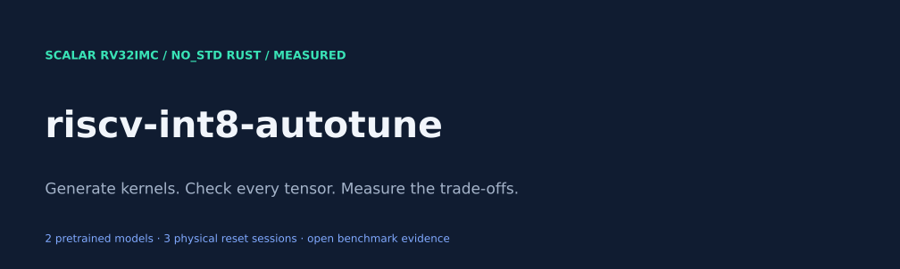
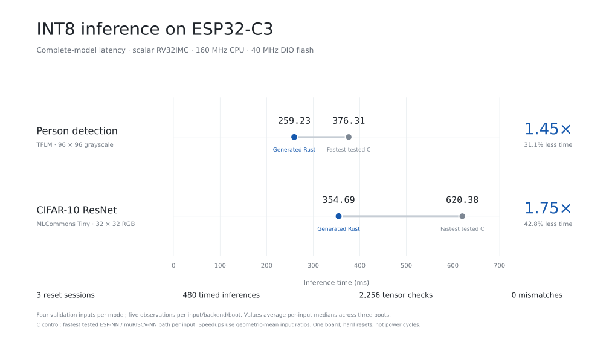
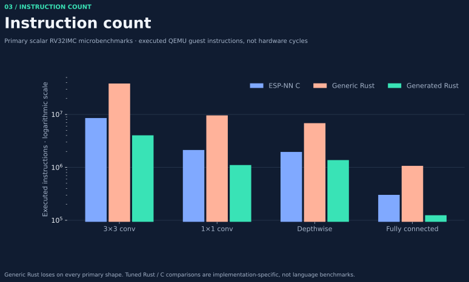
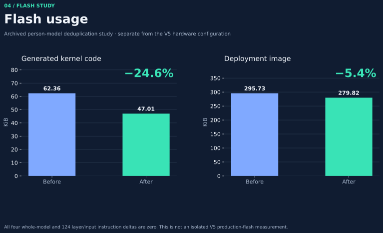
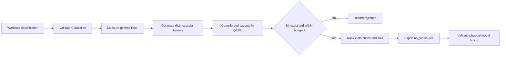

<p align="center">
  
</p>

# riscv-int8-autotune

**Generate, measure, and tune INT8 neural-network kernels for scalar RISC-V.**

A Rust research toolkit that turns workload descriptions into reusable `no_std`
kernels, checks them against independent integer references, and searches for
better instruction-count and code-size trade-offs. It includes an ESP32-C3
benchmark firmware and raw, auditable measurements from two pretrained models.

**RV32IMC · stable Rust · no inference heap · no RVV or packed SIMD · MIT project code**

[Results](#measured-results) · [Quick start](#quick-start) · [How it works](#how-it-works) ·
[Reproduce](docs/reproducibility.md) · [Research](docs/research-summary.md) ·
[Graph gallery](docs/gallery.md) · [Detailed experiments](docs/experiment-guide.md)

## Measured results

On one **ESP32-C3 at 160 MHz, DIO flash at 40 MHz**, fixed generated Rust kernels
beat the fastest tested C implementation on both complete pretrained graphs.
Three independently collected hard-reset sessions passed the local raw-log audit.

| Complete model | Fastest tested C | Generated Rust | C / Rust | Time reduction |
|:--|--:|--:|--:|--:|
| TFLM person detection · 96 × 96 grayscale | 376.31 ms | **259.23 ms** | **1.452×** | **31.1%** |
| MLCommons Tiny CIFAR-10 ResNet · 32 × 32 RGB | 620.38 ms | **354.69 ms** | **1.749×** | **42.8%** |

**1.593× equal-model geometric mean · 2,256 intermediate checks · 480 timed inferences · zero mismatches**



The controls are ESP-NN, stock scalar muRISCV-NN and a separately documented
correction to muRISCV-NN's optional RV32 requantization assembly. The fastest
control is selected per input. Timings average four input medians per boot, each
from five observations, then average three boots. Speedup ratios geometrically
average per-input ratios. Common C graph operators remain in both implementations.
These results compare implementations and memory layouts; they do not isolate the
Rust language or establish superiority over untested systems such as CubeCL or MicroFlow.

[Raw captures](results/hardware-v5/physical-return/captures/) ·
[Strict audit](results/hardware-v5/physical-audit/summary.json) ·
[CSV](results/hardware-v5/physical-audit/runs.csv) ·
[Full physical evaluation](results/hardware-v5/physical-audit/evaluation.md)

**Scope:** one board, three hard resets, four previously used validation fixtures
per model. This is not a power-cycle, cross-board, accuracy, or long-duration
reliability study. Intermittent ESP32-C3 QEMU stalls and earlier staging-firmware
hardware stalls remain undiagnosed. The successful V5 hardware sessions do not
establish their cause. All failed experiments are retained.

### Instructions and flash are separate measurements

The generic bare-metal QEMU suite covers convolution, pointwise, depthwise and
fully connected kernels. On the four primary shapes, tuned Rust uses **a 1.938×
baseline/tuned instruction-count ratio relative to ESP-NN**, and
**1.223× relative to the strongest tested muRISCV-NN configuration including its
local correction**, geometrically averaged. Individual results include wins below
1.2×. Generic Rust was slower than C on every primary workload.



An earlier person-model flash experiment reduced generated code from **63,858 to
48,138 bytes (24.6%)**, with identical instruction counts on every checked input
and layer. Its deployment image shrank **5.4%**. This is a separate archived
configuration, not a production flash-size claim for the V5 diagnostic firmware.



[Instruction evaluation](docs/competitor-evaluation.md) ·
[Flash evaluation](docs/flash-tuning.md) · [All charts](docs/gallery.md)

## What you get

| Component | Purpose |
|:--|:--|
| `crates/kernel-core` and `crates/reference` | Generic kernels, quantization and correctness references |
| `crates/kernel-generator` | Specialized scalar Rust source generation |
| `crates/autotuner` | CLI for baseline measurement, bounded search, comparison and export |
| `generated/` | Reusable kernels and preserved model exports |
| `hardware/esp32c3-v5/` | Fixed four-backend, two-model board benchmark |
| `baselines/` | Pinned upstream C implementations, original licenses retained |
| `results/` | Measurements, raw captures, search candidates and failures |
| `docs/` and `scripts/` | Methodology, reports, visualization and reproducibility tools |

The reusable artifact is a kernel library source file. The host application is a
code generator and tuner. The ESP32-C3 firmware is the hardware validation harness.
This is not a general-purpose replacement for a model training framework.

## Quick start

Linux x86-64 is the validated host. The source archive includes the pinned baseline
sources; initialize submodules only if your checkout contains empty baseline directories.

```bash
bash scripts/setup.sh
source scripts/env.sh
cargo install --locked --path crates/autotuner

riscv-int8 doctor
riscv-int8 init my_conv.toml --operator conv
# Edit dimensions, quantization and resource budgets.
riscv-int8 inspect my_conv.toml
riscv-int8 build my_conv.toml --out artifacts/my_conv
```

Open `artifacts/my_conv/report.html` for the measured comparison. The `export/`
directory is a standalone dependency-free `no_std` crate with a safe Rust entry
point, C ABI header, exact tensor contract and measurement manifest. Every build
measures optimized C first, generic Rust second, then generated candidates in
QEMU; budgets and correctness decide eligibility. Existing research selections
remain intact. Run inside the checkout or set `RISCV_INT8_ROOT` after installation.

[Tool guide and integration example](docs/tool.md) ·
[End-to-end tool validation](results/tool-validation.json)

For the full research QEMU experiment, run `bash scripts/reproduce.sh`. The Docker
recipe and full-evaluation workflow are provided; the Docker build has not been
validated in this environment. Board firmware needs the separate pinned ESP-IDF
toolchain. Model-specific cache-tiled generation remains a separate research
workflow; the simple CLI does not import arbitrary models or promise V5 latency.

### Inspect the evidence without a board

```bash
python3 -m pip install -r requirements.txt
bash scripts/audit-v5.sh
python3 scripts/report_hardware_v5.py
python3 scripts/presentation.py
```

This rechecks the returned physical captures and redraws figures. It does not
perform new physical measurements. See [reproducibility](docs/reproducibility.md)
for model imports, QEMU prerequisites and board build/capture instructions.

## How it works



The generator explores channel blocking, spatial reuse, loop unrolling, partial
im2col and cache-sized signed-INT8 patch tiles. The model path can pack weights
offline, fold zero-point compensation into bias under exact padding semantics,
and specialize requantization after proving its bounds. Generated variants really
change the loop structure; all execution remains scalar RV32IMC.

The tuner records losing configurations and caches measured candidates using
source/configuration/toolchain identities. It supports minimum instructions,
minimum flash, constrained instructions and a Pareto frontier. Read the
[detailed experiment guide](docs/experiment-guide.md) for workload contracts,
resource accounting and commands.

## Research contribution and limits

The contribution is an inspectable, reproducible Rust generation-and-measurement
pipeline with exact INT8 contracts, an instruction/code-size search, and audited
physical model evaluation. Blocking, packing, bias folding, autotuning and patch
tiling are established techniques. Rust alone is not a novelty claim.

The results support these particular kernels and models on the tested scalar
platform. They do not establish a new asymptotic algorithm, universal model
speedup or a broad competitor ranking. The [research summary](docs/research-summary.md),
[related work](docs/related-work.md) and [novelty audit](docs/novelty-audit.md)
explain the distinctions and unresolved questions.

## Contribute and cite

See [CONTRIBUTING.md](CONTRIBUTING.md) for checks and experiment requirements,
[publication checklist](docs/publishing.md) for uploading this repository, and
[CITATION.cff](CITATION.cff) for citation metadata. Project source and generated
Rust kernels are MIT licensed. Upstream baselines, models, fixtures and optional
QEMU plugin components retain their own terms; see [THIRD_PARTY.md](THIRD_PARTY.md).
