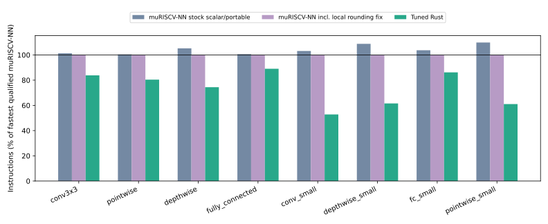

# Further optimization against muRISCV-NN

## Outcome and comparison scope

The four primary workloads achieve **1.246×**
geometric-mean instruction-count improvement against the fastest tested, qualified
**unmodified** muRISCV-NN scalar/portable configuration per workload.
Against the strongest tested, qualified configuration **including our separately labeled
local assembly-rounding correction**, the result is
**1.223×** on the four primary shapes and
**1.379×** across all eight.

These are comparisons of isolated scalar RV32IMC INT8 operators in QEMU, not
claims about all muRISCV-NN targets, RVV performance, complete models, hardware
cycles or elapsed-time speedups. Every workload and any regression remain below.

| Workload | Stock muRISCV-NN | Best incl. local fix | Tuned Rust | Best mu / Rust | Selected Rust |
|---|---:|---:|---:|---:|---|
| conv3x3 | 4,875,226 | 4,811,060 | 4,032,868 | 1.193× | `b2_u1_s0_im2col_p4_qpos` |
| pointwise | 1,381,594 | 1,375,451 | 1,105,945 | 1.244× | `b4_u1_s0_p2_qpos` |
| depthwise | 1,940,678 | 1,843,989 | 1,372,290 | 1.344× | `b4_u1_s1_qpos` |
| fully_connected | 140,648 | 139,788 | 124,485 | 1.123× | `b8_u1_s0_qpos` |
| conv_small | 32,582 | 31,584 | 16,675 | 1.894× | `b2_u1_s1_qpos` |
| depthwise_small | 12,172 | 11,185 | 6,883 | 1.625× | `b1_u1_s1_cxy_qpos` |
| fc_small | 2,625 | 2,531 | 2,181 | 1.160× | `b8_u1_s0_qpos` |
| pointwise_small | 26,795 | 24,389 | 14,885 | 1.638× | `b2_u1_s0_qpos` |




## Fair baseline construction

Upstream: `tum-ei-eda/muriscv-nn` commit
`f69494442858980be78180868d96c3524dbf26f9`, recorded as a submodule and lock file.
The stock source is unchanged. We call the upstream convolution, depthwise and
fully-connected wrappers, allowing their dispatch to choose specialized paths.
The FC wrapper selects per-channel quantization. Standard convolution's filter
layout, NHWC activations, depthwise multiplier one, bias, offsets, activation
clamp and per-channel multiplier/shift arrays are identical to the Rust kernels.
All inputs remain the original eight workloads and deterministic fixture seed.

Both standard scalar code and the `USE_PORTABLE_VEXT` algorithm configuration
are compiled at `-O3 -march=rv32imc -mabi=ilp32`, without LTO. The latter selects
the portable algorithms associated with vector kernels; it does not enable RVV
instructions. We do not compare a scalar-only Rust kernel to an emulator running
a different, more capable ISA. Required scratch is supplied, and setup inside
the kernel callback is counted. Exact source compilation commands and common
archive build cost are retained under `results/upstream-build/`.

The same UART, startup, linker, calibrated instruction region and three-process
repeat protocol are used by every implementation. Both C and Rust use the same
freestanding `memcpy`/`memset`, with aligned 32-bit scalar copies/fills and byte
tails. Host guard/alignment tests exercise those routines. All original selected
Rust kernels were remeasured with this common runtime for a controlled comparison
with the new optimizations; the initial measurements remain in `results/phase-before-muriscv/`.
Memory-library changes are not presented as Rust kernel improvements.

## Additional correctness gate and optional upstream assembly

A separate QEMU test checks upstream requantization on 2,240 scalar cases,
including sign/rounding boundaries and deterministic random values with
nonnegative multipliers and shifts -27..0.

| Configuration | Quantization cases | Mismatches | Eligible for comparisons |
|---|---:|---:|---|
| muriscv | 2,240 | 0 | yes |
| muriscv-portable | 2,240 | 0 | yes |
| muriscv-asm | 2,240 | 104 | no |
| muriscv-portable-asm | 2,240 | 104 | no |
| muriscv-fixed-asm | 2,240 | 0 | yes |
| muriscv-portable-fixed-asm | 2,240 | 0 | yes |


The optional unmodified RV32 assembly path has a reproducible rounding error at
this commit. A minimal example is `val=2, multiplier=1073741824, shift=0`:
expected result **1**, unmodified assembly result **2**. This optional setting is
not enabled by the normal scalar build; the default implementation passes.
We exclude a globally failing numerical configuration even if a particular
operator fixture happens to mask its errors through shifting/clamping.

The RV32 implementation uses `q=low_product>>30` as its rounding contribution,
where the required contribution is `(low_product>>31)+((low_product>>30)&1)`,
equivalently `q-(q>>1)`. A local header overlay corrects the returned result by
subtracting `lo>>1` after the original assembly. It leaves the upstream checkout
untouched, has no input-specific special cases, and passes the same quantization
tests. The `*-fixed-asm` measurements include this correction and are explicitly
not described as unmodified upstream. Raw source, generated overlay, minimal
counterexamples, commands and QEMU output are preserved. This is an observed
bug at a pinned revision, not a claim that all versions of the project are wrong.
No issue or message was sent to upstream maintainers.

## New generated implementations

* Multi-pixel tiles (two or four adjacent outputs) share loaded weights across
  pixels while output-channel blocks share loaded inputs. 3×3 variants use a
  partial INT16 im2col buffer; 1×1 variants read the input directly. Tile filling,
  padding, channel tails, row tails and initial scratch clearing stay timed.
* Depthwise channel-first schedules interchange the channel-block and spatial
  loops, allowing the compiler to reuse filter/quantization metadata differently.
  These schedules are evaluated rather than assumed faster.
* A nonnegative-multiplier/nonpositive-shift requantization path removes general
  signed-nudge/left-shift handling. Generated entry points validate the parameter
  restrictions once per invocation. It is numerically identical under that
  contract; it is not an approximate quantizer. Rust tests compare 11,364 edge
  and deterministic random cases with the general implementation. The existing
  independent C/Python/Rust differential tests remain in place.

Matched candidates below remove one factor while retaining the selected
schedule's other parameters. Effects interact and must not be added together.
Missing pairs are not synthesized.

| Workload | Change removed from selected schedule | With | Without | Without / with |
|---|---|---:|---:|---:|
| conv3x3 | specialized requantization | 4,032,868 | 4,164,342 | 1.033× |
| conv3x3 | spatial tiling | 4,032,868 | 6,334,967 | 1.571× |
| pointwise | specialized requantization | 1,105,945 | 1,269,589 | 1.148× |
| pointwise | spatial tiling | 1,105,945 | 1,379,502 | 1.247× |
| depthwise | specialized requantization | 1,372,290 | 1,670,374 | 1.217× |
| fully_connected | specialized requantization | 124,485 | 125,457 | 1.008× |
| conv_small | specialized requantization | 16,675 | 22,488 | 1.349× |
| depthwise_small | specialized requantization | 6,883 | 11,521 | 1.674× |
| depthwise_small | channel-first loop | 6,883 | 8,566 | 1.245× |
| fc_small | specialized requantization | 2,181 | 2,457 | 1.127× |
| pointwise_small | specialized requantization | 14,885 | 23,517 | 1.580× |


## Progress relative to our previous implementation

| Workload | Previous Rust, remeasured | New Rust | Previous / new |
|---|---:|---:|---:|
| conv3x3 | 4,710,899 | 4,032,868 | 1.168× |
| pointwise | 1,373,728 | 1,105,945 | 1.242× |
| depthwise | 1,670,374 | 1,372,290 | 1.217× |
| fully_connected | 125,457 | 124,485 | 1.008× |
| conv_small | 21,511 | 16,675 | 1.290× |
| depthwise_small | 9,343 | 6,883 | 1.357× |
| fc_small | 2,382 | 2,181 | 1.092× |
| pointwise_small | 20,000 | 14,885 | 1.344× |


The primary-shape geometric mean over the remeasured previous Rust kernels is
1.155×. This controls the common runtime
change and uses actual execution, rather than comparing estimated costs.

## Code and memory costs

| Workload | mu / Rust .text | mu / Rust scratch | mu / Rust stack watermark |
|---|---:|---:|---:|
| conv3x3 | 10,848 / 10,756 | 576 / 1,152 | 1,224 / 1,388 |
| pointwise | 10,802 / 6,976 | 0 / 0 | 408 / 304 |
| depthwise | 12,690 / 8,680 | 0 / 0 | 508 / 304 |
| fully_connected | 10,590 / 6,536 | 0 / 0 | 432 / 304 |
| conv_small | 10,844 / 11,216 | 112 / 0 | 760 / 304 |
| depthwise_small | 12,704 / 8,310 | 0 / 0 | 508 / 304 |
| fc_small | 10,256 / 7,154 | 0 / 0 | 432 / 304 |
| pointwise_small | 10,824 / 7,856 | 32 / 0 | 680 / 536 |


.text includes the common benchmark and linked routines. Scratch is explicitly
included in each kernel's observed stack use. A 64 KiB stack is reserved for all
implementations, and executable flash plus static/reserved RAM are checked against
workload budgets when selecting generated kernels. Watermarks are observations,
not formal worst-case stack bounds. Memory increases are reported rather than
hidden by the instruction metric.

## Regression evidence and limits

Saved additional muRISCV-NN regression records: **96**. These use new
fixture seeds on the same shapes and reject numerical failures. Generated Rust
regressions, the independent executed-instruction callback checks, formatting,
Clippy and Rust/Python tests are recorded alongside the original suite.

The results remain subject to compiler differences (GCC C vs LLVM Rust), workload
specialization, isolated-layer scope, finite correctness samples, and QEMU's lack
of ESP32-C3 cycle/cache modeling. We have not established a general language
advantage. Matched C/Clang schedules and real hardware remain important controls.

CubeCL is a general compute-kernel framework, while RISCVML's referenced poster
is an educational workflow, so neither supplies a directly interchangeable
RV32IMC INT8 operator baseline here. MicroFlow has generated Rust operators but
its inspected quantization epilogue has a different floating-point-based contract;
we do not claim to beat it by silently changing quantization or clamping.
This extension targets an actual compatible competitor rather than declaring
victory over unrelated or numerically different systems.

## Reproduce

```bash
cargo run --locked -p autotuner -- benchmark-competitors
cargo run --locked -p autotuner -- tune all
cargo run --locked -p autotuner -- regression
python3 scripts/regression_muriscv.py
python3 scripts/validate_counter.py
python3 scripts/report_competitors.py
```

`results/competitor-comparison.json` and CSV contain every comparison;
`results/muriscv.json` contains raw successful operator measurements;
`results/muriscv-failures.json` retains rejected executions;
`results/upstream-quantization.json` records qualification and counterexamples.
