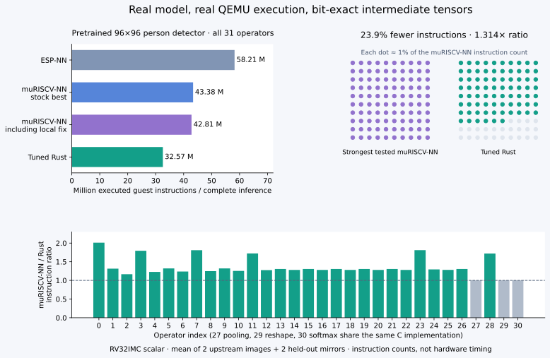

# riscv-int8-autotune

A working scalar RV32IMC INT8 kernel generator and autotuner in Rust, evaluated
on bare-metal QEMU against the original ESP-NN C3-appropriate optimized C kernels.
Target kernels are `no_std`, allocate no heap, and use no RVV or packed SIMD.

<!-- HARDWARE_V5_RESULTS_START -->
**ESP32-C3 hardware: three audited hard-reset sessions passed** 2,256 tensor
checks and 480 complete-model timed inferences with zero mismatches. Fixed Rust
kernels take **259.23 ms vs 376.31 ms** for person detection (**1.452×**) and
**354.69 ms vs 620.38 ms** for CIFAR-10 ResNet (**1.749×**), against the fastest
tested C controls in the same image. Equal-model geometric mean: **1.593×**.
This covers one board and previously used validation inputs. Intermittent QEMU
stalls remain undiagnosed; hardware success does not establish their cause.
[Physical evaluation and graph](../results/hardware-v5/physical-audit/evaluation.md).
<!-- HARDWARE_V5_RESULTS_END -->

<!-- FLASH_RESULTS_START -->
**Flash tuning, no instruction regression:** shared generated Rust bodies reduce
code **63,858 → 48,138 bytes (24.6%)**.
The full model firmware image shrinks **302,832 → 286,536 bytes (5.4%)**.
All four inference counts and all 124 layer/input counts remain exactly unchanged;
the **1.314×** comparison against the strongest tested muRISCV-NN path is preserved.
[Flash report](../docs/flash-tuning.md) · [Preferred compact source](../generated/person-detection/flash/kernels.rs)
<!-- FLASH_RESULTS_END -->

<!-- MODEL_RESULTS_START -->
**Complete pretrained model:** the 96×96 TFLM INT8 person detector (31 operators)
uses **32.57 million instructions** with selected Rust kernels,
versus **42.81 million** for the strongest tested scalar muRISCV-NN
configuration (**1.314×**, **23.9% fewer instructions**) and
**58.21 million** for ESP-NN (**1.787×**).
All intermediate tensors match independent LiteRT inference on two upstream
images and two held-out mirrors. [Full-model report](../docs/model-evaluation.md)
includes code-size costs, metadata repair, prediction errors and real measurements.


<!-- MODEL_RESULTS_END -->

<!-- RESULTS_START -->
**Measured instruction-count improvement: 1.938× over ESP-NN and
1.246× over the fastest tested unmodified muRISCV-NN
scalar/portable configuration, geometrically averaged over the four requested shapes.**

Including a separately labeled local correction to muRISCV-NN's optional RV32
requantization assembly, the comparison is **1.223×**.
These are executed QEMU guest instruction ratios, not hardware cycles or measured
execution-time speedups. The complete eight-shape result versus ESP-NN is
2.077×.

| Workload | ESP-NN | Best muRISCV-NN incl. local fix | Tuned Rust | Best mu / Rust |
|---|---:|---:|---:|---:|
| 16×16×16 → 16×16×32, 3×3 | 8,546,046 | 4,811,060 | 4,032,868 | 1.193× |
| 16×16×32 → 16×16×32, 1×1 | 2,129,234 | 1,375,451 | 1,105,945 | 1.244× |
| 32×32×16 depthwise, 3×3 | 1,955,993 | 1,843,989 | 1,372,290 | 1.344× |
| 256 → 128 fully connected | 302,154 | 139,788 | 124,485 | 1.123× |
<!-- RESULTS_END -->


The 1.2× aggregate target against ESP-NN was met. The muRISCV-NN comparison
also reports individual cases below 1.2×, alongside the aggregate.
Generic Rust was slower than C on every workload. Some generated variants also
regressed, and selected kernels sometimes increase code size or stack usage.
All results, including losing candidates, are retained.

[Before/after dot-matrix graphic](../docs/figures/before-after.png) · [Vector version](../docs/figures/before-after.svg)

Regenerate it with `python3 scripts/visualize_before_after.py`.

## Start here

* [Additional muRISCV-NN evaluation](../docs/competitor-evaluation.md): new kernels,
  fair upstream configurations, the optional rounding defect/correction, and all measurements.
* [muRISCV-NN comparison plot](../docs/figures/vs-muriscv.svg).

* [Novelty audit](../docs/novelty-audit.md): closest prior Rust projects, defensible
  contribution wording, and what remains unproven.

* [Technical report](../docs/report.md): methodology, all results, ablation, code/memory
  trade-offs, assembly evidence, limits and future hardware validation.
* [Related work](../docs/related-work.md): ESP-NN, CMSIS-NN, muRISCV-NN, microTVM,
  AutoTVM/Ansor, MicroFlow and other prior work. No novelty claim based on Rust.
* [Machine-readable comparison](../results/comparison.json) and [CSV](../results/comparison.csv).
* [Reusable kernels](../generated/export/) and [all candidate measurements](../results/candidates.json).
* [Independent counter cross-check](../results/counter-crosscheck.json).

## Setup

The validated host is Debian 13 x86_64 with `cc`, Git, curl, dpkg/apt, Python 3.11+
and Matplotlib installed. Kernel microbenchmarks use only Python's standard
library. The optional pretrained-model suite also needs `requirements-model.txt`;
run it with `bash scripts/reproduce-model.sh` after installing those dependencies.
Plotting uses Matplotlib; `requirements.txt` pins the rendering version
used here. On a minimal Debian host, install `build-essential git curl python3
python3-venv python3-matplotlib ca-certificates` first, or use the Docker recipe.

```bash
# For a Git checkout (the archive already includes upstream source):
git submodule update --init --recursive
bash scripts/setup.sh
source scripts/env.sh
```

`setup.sh` downloads/extracts pinned Debian snapshot tool packages into `.tools/`
without sudo or changes to the system package database. It installs stable Rust
1.90.0, the `riscv32imc-unknown-none-elf` target, rustfmt and Clippy. GCC is
14.2.0 and QEMU is 10.0.13. Cargo dependencies are locked. Package checksums and
observed executable hashes are recorded in `docs/tool-packages.json` and
`docs/toolchain-hashes.json`. Existing installations can be selected with
`RISCV_CC`, `QEMU`, and `RISCV_TOOLS_PREFIX`; changed versions invalidate the cache.

For a Python environment with the exact plotting version:

```bash
python3 -m venv --system-site-packages .venv
source .venv/bin/activate
python3 -m pip install -r requirements.txt
```

The provided Dockerfile uses a Debian package snapshot and the pinned Rust
version:

```bash
docker build -t riscv-int8-autotune .
docker run --rm riscv-int8-autotune
```

Local setup and execution were tested for this evaluation. The Docker build
recipe is provided but was not executed in this session.

## Reproduce the experiment

```bash
bash scripts/reproduce.sh
```

Or run the phases individually:

```bash
cargo run --locked -p autotuner -- benchmark-baseline
cargo run --locked -p autotuner -- benchmark-rust
cargo run --locked -p autotuner -- benchmark-competitors
cargo run --locked -p autotuner -- tune workloads/conv3x3.toml
cargo run --locked -p autotuner -- tune all
cargo run --locked -p autotuner -- regression
bash scripts/build-plugin.sh
python3 scripts/validate_counter.py
cargo run --locked -p autotuner -- export
cargo run --locked -p autotuner -- compare
```

Baseline measurements must succeed and be saved before Rust measurements;
generic Rust must be measured before tuning. Each new workload specification is
validated against C and generic Rust before its candidates are generated. All
reported CLI commands execute real work. `compare` builds the Markdown report,
JSON/CSV tables and SVG/PNG/PDF plots exclusively from saved measurements.

The current full search evaluates 588 candidates. Cached reruns skip compilation
and QEMU execution when configuration, source/dependencies, compiler identity/binary hashes,
flags, oracle and harness match. Each uncached candidate is compiled, executed in
three fresh QEMU processes, checked against every expected output byte, and
measured. Runtime host timings record tuning cost only.

## Workload specifications and objectives

The TOML files in `workloads/` specify dimensions, operator, stride/padding,
input/output offsets, quantization shift, activation limits, deterministic seed,
ISA and flash/SRAM budgets. Optional `multipliers = [...]` and `shifts = [...]`
provide exact per-output-channel quantization arrays; otherwise the deterministic
convention documented in the report applies. Runtime-generated kernels still
accept multiplier/shift arrays as arguments.

The supported subset is batch one, square 1×1 or 3×3 kernels, NHWC activations,
OHWI standard filters, HWC depthwise filters, dilation one and depthwise channel
multiplier one. Fully connected maps to a single-pixel dot product. Positive
requantization shifts are supported by the arithmetic implementation and tested,
but tuning specifications use nonpositive shifts to avoid accumulator overflow.
INT32 accumulation must fit. Unsupported combinations fail validation.

```bash
cargo run --locked -p autotuner -- tune workloads/conv3x3.toml min-instructions
cargo run --locked -p autotuner -- tune workloads/conv3x3.toml min-flash
cargo run --locked -p autotuner -- tune workloads/conv3x3.toml budget
cargo run --locked -p autotuner -- tune workloads/conv3x3.toml pareto
```

These commands update that workload's selected result. The default is minimum
instructions. All objectives enforce the TOML flash/SRAM constraints; `budget`
selects minimum instructions under the flash budget. `pareto` saves the frontier
and selects its fastest feasible member. Equal instruction counts prefer smaller
flash. SRAM feasibility includes the full 64 KiB reserved stack. Flash includes
the whole linked benchmark and immutable fixtures/oracle, which is conservative
for deployment. `results/best-NAME.json` saves the selection and frontier.

## Generated code

The search emits genuinely different safe-slice Rust loop bodies: channel blocks
1/2/4/8 (plus FC block 16), reduction unrolling, spatial unrolling, interior/border splitting,
channel-first depthwise loops, two-/four-pixel tiles, and INT16 partial im2col.
An optional exact requantization path exploits nonnegative multipliers and
nonpositive shifts; the generated entry point checks that contract once per call. No hand-written inference assembly
is used. Quantization, bias and activation clamping are fused in every variant.
The selected main convolution uses 1152 bytes of local stack scratch; other
selected primary kernels need no scratch. Scratch filling stays inside the timed
region.

```bash
cargo run --locked -p autotuner -- export conv3x3 /tmp/exported-kernels
rustc --edition=2021 --crate-type=rlib \
  --target=riscv32imc-unknown-none-elf -C opt-level=3 \
  /tmp/exported-kernels/conv3x3.rs
```

Exported files are independent of this workspace and external crates. They
provide `run(input, weights, bias, mult, shift, output)` with caller-owned slices,
plus a documented unsafe C ABI exported under the unique symbol
`riscv_int8_WORKLOAD`. Stack scratch, where present, is allocated locally and
explicitly recorded in source comments and result metadata. Link the exported
file as a library or include it as a module in an existing `no_std` application.
The application supplies its own panic handler, startup, allocator policy and
linker layout. No allocator is required by these kernels.

## Measurement and correctness

QEMU uses `virt`, `lowrisc-ibex`, one RV32IMC hart, no BIOS, and
`-icount shift=0,align=off,sleep=off`. The inference ISA is RV32IMC; measurement
CSR reads require Zicsr. `rdinstret` brackets only the kernel callback. Empty-call
overhead is measured and subtracted. Known-length loops calibrate the counter;
an independent execution-callback plugin exactly matched the CSR counts for C
and generated kernels on all four small workloads; the additional evaluation
also cross-checks the selected upstream variants. Compressed instructions
count once. These are dynamic guest instructions, not translated blocks or host
operations.

Every output is checked against an independent Python integer oracle with the
same padding, bias, zero points, per-channel quantization and activation clamp.
The tests cover 3,390 host requantization cases against original C and Rust,
11,364 checks of the restricted Rust quantizer, 2,240 QEMU quantization cases per
upstream configuration, and
72 additional operator executions in QEMU across three fresh seeds, each with
three process repeats. An additional 96 operator executions check the qualified
muRISCV-NN variants on fresh seeds. Incorrect compiled kernels must be rejected
on both fresh execution and cache lookup.
Test coverage is not a proof over arbitrary inputs.

```bash
cargo fmt --all -- --check
cargo clippy --locked --workspace --all-targets -- -D warnings
cargo test --locked --workspace
python3 -m unittest discover -s tests -v
```

## Layout and evidence

```text
crates/kernel-core/       no_std generic operators and quantization
crates/reference/         public reference API and host quantization checker
crates/kernel-generator/  Rust workload parsing and source generation
crates/autotuner/         Rust grid search, selection, export and orchestration CLI
baselines/esp-nn/         pinned unmodified upstream submodule
baselines/muriscv-nn/     pinned unmodified upstream submodule; corrections use a separate overlay
scripts/                  Python fixture/build/QEMU backend, tests and reporting
qemu/                     boot, linker, common harness and independent count plugin
workloads/                eight TOML specifications
results/                  actual JSON/CSV measurements, logs and phase milestones
generated/                candidate source and independently reusable exports
docs/                     report, related work, plots and hardware protocol
```

Content-hashed `results/build/` directories retain the target ELF, generated
source/fixtures, assembly, map, section/ISA listings, raw QEMU logs and JSON.
They are ignored by Git and regenerated by the commands above. The project
archive includes the evidence from this run. Original C sources remain unmodified.
`results/phase-e/` preserves the first search, including losing variants, before
the second round of transformations. `results/assembly-analysis.csv` identifies
selected and regressing assembly artifacts.

Build intermediates consume several GiB during a full experiment. Afterward,
`python3 scripts/prune-build-cache.py` removes only `.o`/`.a` files from completed
builds; it preserves source, ELF and measurement evidence. Use `--force` with
`scripts/runner.py baseline` to repeat the C measurements instead of using cache.

## Limits and license

QEMU does not model ESP32-C3 flash/cache, pipeline timing, energy or peripherals.
This study compares workload-specialized Rust/LLVM with reusable ESP-NN/GCC;
it does not isolate a language effect. Hardware validation is future work; see
[the proposed protocol](../docs/hardware-validation.md). No ESP32-C3 timing result
or ready-to-flash ESP32-C3 image is claimed.

Project Rust code and generated kernels: MIT. ESP-NN and muRISCV-NN: Apache-2.0. Optional QEMU
plugin/header: GPL-2.0-or-later. See [third-party attribution](../THIRD_PARTY.md).

### Physical ESP32-C3 validation

The [returned-board audit](../results/hardware-esp32c3/analysis/report.md) records a
correct full-model run on an ESP32-C3 SuperMini at 160 MHz. The QEMU-selected Rust
candidate used 13.3% fewer cycles than the earlier Rust version, but took about
25% more cycles than the fastest tested scalar muRISCV-NN configuration. Thus a
QEMU instruction-count lead did **not** establish a hardware-cycle lead.
Repeated-boot independence is unresolved because two returned captures are
byte-identical; the audit excludes duplicate captures from aggregation.

`python3 scripts/tune_hardware_cache.py` generates and QEMU-validates two
channel-first pointwise candidates aimed at the large-layer flash working set.
They do not replace the existing selected kernels. `python3
hardware/esp32c3/prepare.py --cache-candidates` includes both in the v2 hardware
diagnostic, which requires 4 MB flash. The [v2 returned-log evaluation](../results/hardware-cache/analysis/report.md) shows cache2 at **258 ms versus 367 ms** for the fastest tested C configuration (**1.424×**, 29.8% less inference time), with zero reported mismatches. All whole-model cycle sequences repeat exactly across distinct boot identifiers; these are not pooled as independent timing observations. The [hardware-selected sources](../generated/person-detection/hardware/) preserve this qualification and leave previous exports intact.

### Independent timing capture and a second model (v3)

The [two-model diagnostic](../hardware/esp32c3-v3/README.md) uses host-issued random
challenges, independently triggered observations, randomized backend order and
sub-tick phase, host send/receive timestamps, and requested-delay calibration.
Its auditor checks the raw transport records against the full LiteRT tensor
oracle and compares host/device clocks before accepting repeatability evidence.
The same 112,144-byte tensor arena runs the existing person detector and an
unmodified MLPerf Tiny INT8 CIFAR-10 ResNet with residual adds and ten classes.
The exact bootable image and host protocol pass functional ESP32-C3 QEMU tests;
new physical repeatability and second-model timing remain pending board captures.

Second-model reproducibility:

```sh
python3 scripts/resnet_model.py
python3 scripts/benchmark_resnet.py
python3 scripts/benchmark_resnet.py --generic
python3 scripts/tune_resnet.py
python3 hardware/esp32c3-v3/prepare.py
idf.py -C hardware/esp32c3-v3 build
```

Actual QEMU raw guest-instruction means for ResNet: strongest tested corrected
scalar muRISCV-NN 54,045,386.75; generic Rust 413,071,028.5; selected generated
Rust 45,374,096.5. This is about 1.19× fewer guest instructions versus that C
configuration, below the 1.2× target. It is not a board inference-time speedup.
See `results/model/cifar10-resnet/` for all candidates, regressions and exact
per-operator checks. The four fixtures are performance/correctness samples,
not a dataset accuracy evaluation or official MLPerf submission.

### V3 physical results: repeatable win on one model, regression on another

The [locally audited v3 captures](../results/hardware-v3/physical-audit/evaluation.md)
pass all challenge/response, phase-variation, calibration, host/device clock and
reference-output checks: three fresh reset sessions, 2,256 intermediate checks,
480 timed inferences and zero mismatches. Timing sequences are distinct. USB
power was unchanged; this is not a cold-power or cross-board validation.

| Model | Fastest tested C | Generated Rust | C/Rust |
|---|---:|---:|---:|
| Person detector | 376.13 ms | **259.23 ms** | **1.451×** |
| CIFAR-10 ResNet | **620.78 ms** | 682.28 ms | 0.910× |

Values are median across three boot means of four input medians, with five
observations per input. Speedup uses the per-input geometric mean. Person
inference takes 31.1% less time; ResNet takes 9.9% more. The equal-weight
geometric mean across both models is **1.149×**, below the 1.2× target. The
ResNet loss is retained and requires hardware-directed optimization; its
QEMU instruction advantage did not predict hardware timing. The earlier
"pending" statements describe the state before these returned measurements.

[Two-model graph](../results/hardware-v3/physical-audit/two-model-comparison.png).
Reproduce the table and plots with `python3 scripts/report_hardware_v3.py`
after running the v3 auditor on the original capture prefixes.

## V4: cache-tiled convolution and hardware-directed selection

The V3 physical ResNet regression remains the latest measured result. V4 adds a
reusable scalar Rust convolution generator with larger INT8 patch tiles, packed
weight reuse, and optional whole-layer SRAM staging in a liveness-proven free
region of the existing padding workspace. The measured person Rust export is
unchanged. All candidates pass full intermediate tensor checks.

A host-driven firmware now profiles layers on two training inputs, freezes separate
Rust-only and C/Rust hybrid schedules, checks composed graph correctness, and
measures held-out whole-model latency on two other inputs. Later resets reuse the
same selection. A layer-level win is not automatically promoted to a model win.
The final image passed two complete ESP32-C3 QEMU protocol sessions; **physical V4
performance is pending**, and emulator timing is not treated as hardware evidence.

The best fixed ResNet tile uses 44,996,311 mean guest instructions and 38,054 bytes
of linked text, versus previous Rust's 45,374,096.5 and 41,530 bytes. Explicit patch
scratch increases from 2,304 to 9,216 bytes; static tensor memory and the diagnostic
16 KiB task-stack reservation remain unchanged. The retained per-block staging
ablation regresses instruction count. C still has smaller linked text.

See [evaluation and limitations](../results/hardware-v4/evaluation.md),
[measured plot](../results/hardware-v4/cache-tile-tradeoffs.png),
[firmware protocol](../hardware/esp32c3-v4/README.md), and
[local flashing/capture instructions](../hardware/esp32c3-v4/AGENT_PROMPT.md).

```sh
python scripts/tune_cache_tiles.py
python scripts/test_cache_tiles.py
python hardware/esp32c3-v4/prepare.py
# In the pinned ESP-IDF v5.4.2 environment:
idf.py -C hardware/esp32c3-v4 build
# After receiving and auditing three physical capture prefixes:
python scripts/export_hardware_v4.py path/to/audit-results/summary.json --output generated/cifar10-resnet/hardware-v4
```

### Physical V4 return and recovery V4.1

V4 did **not** complete on the physical board: all three attempts stalled on the
first ResNet whole-weight SRAM-staging profile. Fixed tensor checks passed
(4,512 comparisons total). The 62 completed training profiles include promising
cache-tile timings, but there are no held-out RUNs or validated new speedups.
[Local audit and observations](../results/hardware-v4/physical-audit/evaluation.md).

Recovery [V4.1](../hardware/esp32c3-v4_1/README.md) quarantines the whole-weight staging
path and substitutes the separately tested per-block staging kernel, retaining
the other tile candidates. It adds progress diagnostics and rejects stale firmware
before benchmarking. This is a workaround pending physical validation; it does
not identify or claim to resolve the root cause. The previous person kernel export
is preserved. Use the new [flashing instructions](../hardware/esp32c3-v4_1/AGENT_PROMPT.md),
and stop after the first failure if one occurs.

### V4.1 physical update: first held-out win, second reset incomplete

The first V4.1 board session passed the local hardware audit: 1,880 tensor checks,
96 training profiles and 400 complete-model timings. On held-out inputs, selected
Rust takes 258.810 ms versus 376.024 ms C for person detection (1.453×), and
343.765 ms versus 621.289 ms C for ResNet (1.807×). The equal-model geometric mean
is 1.620× **in that single session**. The second reset stalled after backend 6's
warmup, even though it now uses per-block staging; no third session was attempted.
Independent repeatability remains unproven and no export is promoted. See the
[full local audit and failure interpretation](../results/hardware-v4_1/physical-audit/evaluation.md).

### V5 fixed-kernel benchmark image

[Fixed V5 benchmark](../hardware/esp32c3-v5/README.md) removes the PROFILE/SELECT phase
and both staging candidates. It retains the person export and fixes ResNet to the
non-staging tile16_b2p4 family, previously observed at 1.761× C on V4.1 held-out
fixtures in one session. It does not use the 1.807× mixture that included staging.
Four backends, two models, 752 tensor checks and 160 complete RUN observations per
reset; no retuning or selection sidecar. The [local-agent instructions](../hardware/esp32c3-v5/AGENT_PROMPT.md)
request three fresh reset captures. All three returned captures now pass the local
physical audit: 1.452× person detection and 1.749× ResNet versus fastest tested C.
Removing an experimental path does not diagnose the older stall.
