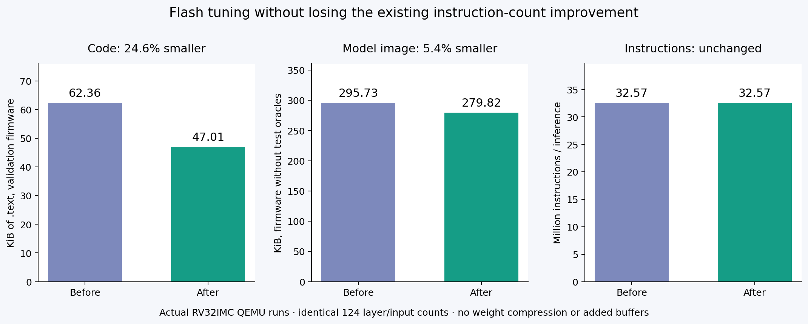

# Flash tuning with strict non-regression

The selected `dedup-O3` candidate reduces full validation firmware
code from **63,858 to 48,138 bytes**:
**15,720 bytes saved (24.6%)**. It also saves
**576 read-only bytes**.
All four full-inference instruction counts and all 124 profiled layer/input
counts are **exactly unchanged**. Thus the prior **1.314×** instruction-count
improvement versus the strongest tested muRISCV-NN path is preserved.

These are scalar RV32IMC QEMU instruction counts, not real hardware cycles or
latency. Preserving QEMU counts cannot guarantee identical instruction-cache
behavior or timing on ESP32-C3 hardware.



## Real firmware image, not test-oracle storage

The validation ELF contains four images and all intermediate expected tensors.
Its roughly 1.2 MB of read-only storage must not be advertised as model flash.
We also linked and actually executed two firmware images containing only model
parameters, code, common graph operations and a RAM input buffer. No test images
or expected tensors are linked; symbols are checked for their absence.
Both images use the same explicit section-alignment policy. Small `.srodata`
objects are collected into `.rodata`; BSS starts aligned to 16 bytes. This avoids
mistaking address-dependent alignment padding for extra tensor RAM.

| Metric | Before | After | Change |
|---|---:|---:|---:|
| Validation firmware `.text` | 63,858 B | 48,138 B | −15,720 B |
| Deployment `.text` | 59,182 B | 43,462 B | −15,720 B |
| Deployment `.rodata` | 243,648 B | 243,072 B | −576 B |
| **Actual `.bin` file size** | **302,832 B** | **286,536 B** | **−16,296 B (5.4%)** |
| Deployment static RAM | 121,360 B | 121,360 B | +0 B |
| Full model instructions, four-input mean | 32,571,202.75 | 32,571,202.75 | 0 |
| Maximum validation stack watermark | 708 B | 708 B | 0 |

The complete image shrinks less than code alone because pretrained weights
dominate flash. Model parameters are untouched: no compression, decoding,
retraining, altered quantization, extra scratch storage or weight copies.
The `.bin` size includes alignment gaps; section totals are separately recorded.
These are QEMU-virt deployment-style firmware artifacts, not flashed ESP32-C3
firmware. The fifth input is an all-zero quantized image supplied from RAM.
Its output `[72, -72]` matches independent LiteRT, and its measured region
is exactly **32,578,621 instructions** in both images.

## Transformation

The original generator emitted **28** separate Rust `run` bodies.
Exact emitted-code comparison identifies identical implementations after removing
comments and entry-point names. The compact source contains **20**
bodies. Repeated 6×6×128 depthwise and 6×6×128→128 pointwise layers share bodies;
all 28 original C-callable layer entry points remain present.

Weights, biases, multipliers and shifts remain runtime arguments, so sharing a
body does not share tensor values. Geometry, offsets, bounds, clamps and schedules
must match in the actual emitted code. The duplicate wrapper calls the canonical
Rust body directly. It adds no extra dispatch layer compared with the original
wrapper-to-body structure. Actual instruction measurements confirm this.

All target code remains `no_std`; no heap allocation or new inference assembly.
Both original and winning builds use `-O3` / Rust `opt-level=3`, no LTO, RV32IMC.

## Search, including rejected smaller candidates

Nine candidates explore source-body sharing, shared out-of-line requantization,
and Rust optimization levels `3`, `s`, `z`. The size levels are controls, not the
project contribution; winning source actually contains different body sharing.
Acceptance requires all of the following, with **zero tolerance**:

* Bit-exact LiteRT outputs, identical sample and layer identities.
* No instruction increase on **any** of the four full inferences or **any** of
  the 124 profiled layer/input regions.
* No static RAM or per-input stack watermark increase.
* No code-size increase, and strictly smaller combined code/read-only storage.

| Candidate | `.text` bytes | Mean instructions | Accepted | Reason if rejected |
|---|---:|---:|---|---|
| dedup-O3 | 48,138 | 32,571,202.75 | Yes |  |
| dedup-Os | 48,562 | 33,790,207.50 | No | whole-model instructions: person, whole-model instructions: no_person |
| dedup-Oz | 55,924 | 48,864,238.50 | No | no read-only image reduction, whole-model instructions: person |
| outline-O3 | 57,554 | 35,097,499.75 | No | whole-model instructions: person, whole-model instructions: no_person |
| outline-Os | 63,084 | 36,052,750.50 | No | no read-only image reduction, whole-model instructions: person |
| outline-Oz | 73,352 | 56,766,182.50 | No | text_bytes, static_ram_bytes |
| dedup-outline-O3 | 44,114 | 35,097,499.75 | No | whole-model instructions: person, whole-model instructions: no_person |
| dedup-outline-Os | 44,116 | 36,052,750.50 | No | whole-model instructions: person, whole-model instructions: no_person |
| dedup-outline-Oz | 50,734 | 57,718,931.50 | No | whole-model instructions: person, stack: person |

Outlining requantization can shrink code further, but it increases instructions;
those results are retained and rejected. Size-oriented compiler settings also
regress performance here. The fastest original selection remains available as
an immutable fallback. The eight prior microbenchmark kernel exports and their
measurements are unchanged.

## Validation and reuse

The frozen original source was independently rebuilt and rerun before search;
its code size and counts match the historical result. Each of the nine candidates
runs three fresh QEMU processes on four inputs, checking every intermediate
tensor. The production-style images additionally run three times on a fifth
input never used for selection. Eight independent QEMU executed-instruction
plugin checks match the original and compact model CSR regions exactly.

Rust tests verify that only identical emitted code is shared and that original
entry points remain. Selection tests reject even a single extra instruction,
changed tensor output, sample identity, stack or RAM regression. Existing Rust
and Python correctness tests, formatting and Clippy pass.

```sh
cargo run --locked -p autotuner -- tune-flash
bash scripts/build-plugin.sh
python3 scripts/evaluate_flash.py
python3 scripts/report_flash.py
```

Or run `bash scripts/reproduce-flash.sh` after the normal model/toolchain setup.

* Preferred compact source: [kernels.rs](../generated/person-detection/flash/kernels.rs).
  It exposes the same 28 layer symbols and accepts the same tensor buffers.
* Preserved original: [kernels.rs](../results/flash/reference/kernels.rs).
* [All candidate measurements](../results/flash/candidates.json),
  [strict selection evidence](../results/flash/best.json),
  [deployment images and counter checks](../results/flash/deployment-comparison.json).
* Actual QEMU firmware files:
  [before](../results/flash/deployment/before/model.bin) and
  [after](../results/flash/deployment/after/model.bin).

The optimized source is exported separately so rerunning the original model
study cannot overwrite it. The original model report remains the record of the
original performance experiment; this report records its compact successor.
