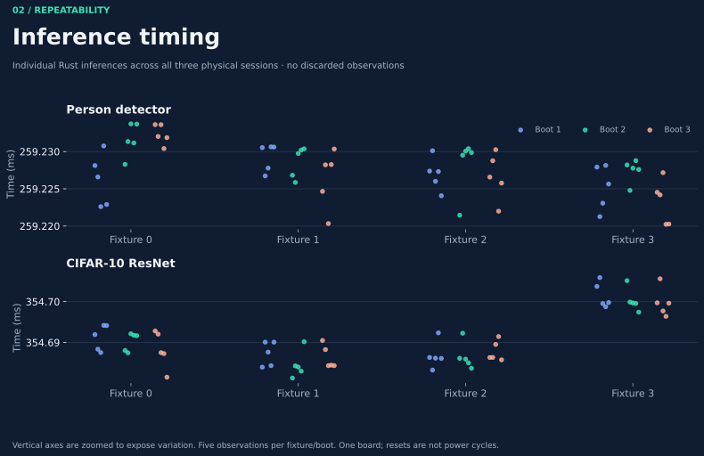
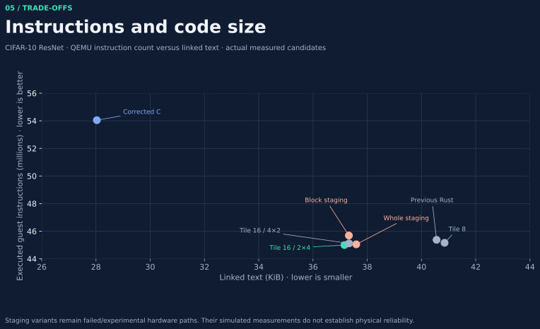

# Figure gallery

All numeric figures are rendered from saved benchmark data. Regenerate with
`python3 scripts/presentation.py` after installing `requirements.txt`. Each chart
has SVG, PNG and PDF versions in `docs/figures/project/`. Input file SHA-256 hashes
are retained in [data-provenance.json](figures/project/data-provenance.json).

## Physical inference timing

Actual V5 board measurements, four input medians per model and three hard-reset
sessions. C means the fastest of three tested C variants per input.

## Every Rust timing observation

The vertical scales are deliberately zoomed to reveal variation. Every one of
the 120 Rust RUNs is visible; no jitter or confidence interval was fabricated.

## Generic Rust versus generated loops

Logarithmic scale; executed guest instructions, not hardware latency. The generic
Rust baseline is retained even though it loses.

## Archived flash reduction

This earlier model configuration is separate from V5 hardware; its instruction
counts remain identical while function sharing saves generated code.

## Code/performance trade-off

Candidate measurements include staging regressions. Simulated points do not
establish physical reliability of the corresponding firmware.

## Social assets

[LinkedIn cover](../media/linkedin/linkedin-cover.png) ·
[Four-slide PDF](../media/linkedin/carousel.pdf) ·
[Post draft](../media/linkedin/POST.md).
The social kit carries the same one-board scope and unresolved-failure caveats.
