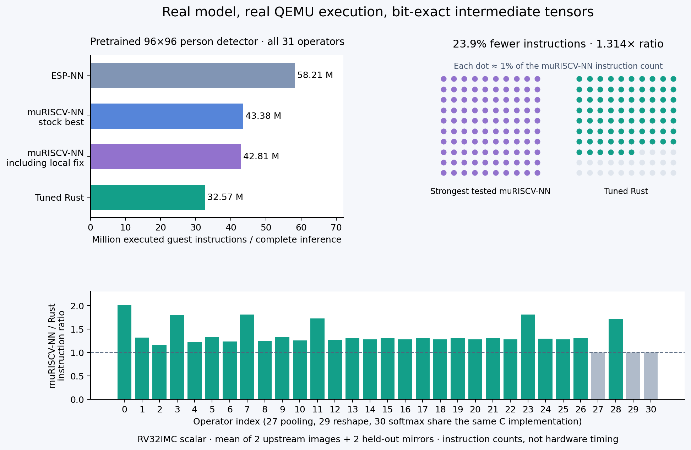

# Complete pretrained person-detector evaluation

The generated Rust convolution/depthwise kernels execute the pinned TensorFlow
Lite Micro 96×96 INT8 MobileNet person detector with a **1.314×**
instruction-count improvement versus the fastest tested qualified muRISCV-NN path
(including its separately documented local assembly rounding correction),
**1.332×** versus the best unmodified scalar/portable path, and
**1.787×** versus ESP-NN. More plainly, the strongest muRISCV-NN comparison
uses **23.9% fewer executed instructions** for Rust.

These are full-network QEMU guest instruction measurements, not hardware cycles,
latency, energy, dataset accuracy, or a comparison against a full TFLM runtime.
All backends use the same static graph runner; convolution/depthwise kernels
are substituted. Pooling, reshape, padding and softmax are included in the whole
inference count. The Rust backend is a mixed-language network: the 28 learned
layers use Rust, and common graph/pooling/softmax code uses C.



## Model and independent reference

* Upstream: TensorFlow Lite Micro, commit
  `64b3de836daf42ef5094d06035742c058e7638f6`.
* Original model SHA-256: `808cfdfc0cf3a6fa6f6fa26bfa379ea97c16d5db7334637766e39c3408502e9d`.
* Weights are pretrained upstream weights. There is no training, pruning, model
  replacement, weight approximation or change to quantization scales.
* Independent oracle: **LiteRT 2.1.0 BUILTIN_REF (no delegates)**. No delegate, one host thread,
  all intermediate tensors preserved. Every layer output is compared byte for
  byte against this separately executed interpreter.
* The original upstream model has invalid `quantized_dimension=3` on 14 rank-one
  bias tensors. Current LiteRT rejects it. The importer repairs only these 14
  axis metadata fields to zero. Exactly 14 bytes differ. Weights, bias values,
  scales, zero points, operator graph and options are unchanged. The original,
  compatible copy and exact repair offsets are preserved; a unit test checks
  that these are the only byte changes.
* Input images are the pinned upstream `person.bmp` and `no_person.bmp`, decoded
  as 96×96 grayscale and quantized with `pixel - 128` as used by this example.
  Horizontal flips are reserved for validation, not schedule selection.

## Full-model measurements

Arithmetic means over four inputs. Each complete firmware runs in three fresh
QEMU processes with exactly matching outputs and counts. Startup, image decoding,
oracle comparisons, UART printing and the separate profiling pass are excluded.
Padding materialization, graph dispatch, pooling, reshape and softmax are included.
The empty measurement wrapper cost is subtracted from the full-network region.

| Implementation | Instructions / inference | `.text` bytes | Static RAM bytes | Stack watermark bytes | Strongest mu / implementation |
|---|---:|---:|---:|---:|---:|
| ESP-NN | 61,049,258.75 | 29,446 | 112,648 | 828 | 0.701× |
| muRISCV-NN scalar | 43,813,436.00 | 35,258 | 112,644 | 820 | 0.977× |
| muRISCV-NN portable algorithm | 43,378,089.25 | 32,188 | 112,644 | 5,212 | 0.987× |
| muRISCV-NN scalar + local rounding fix | 42,814,564.00 | 35,664 | 112,640 | 824 | 1.000× |
| muRISCV-NN portable + local rounding fix | 43,291,200.00 | 32,694 | 112,648 | 5,200 | 0.989× |
| ESP-NN (native first depthwise) | 58,206,622.50 | 29,450 | 112,640 | 828 | 0.736× |
| muRISCV-NN scalar (native first depthwise) | 44,002,384.00 | 35,260 | 112,640 | 636 | 0.973× |
| muRISCV-NN portable algorithm (native first depthwise) | 43,460,163.00 | 32,252 | 112,640 | 5,212 | 0.985× |
| muRISCV-NN scalar + local rounding fix (native first depthwise) | 42,984,302.00 | 35,666 | 112,648 | 636 | 0.996× |
| muRISCV-NN portable + local rounding fix (native first depthwise) | 43,236,374.75 | 32,758 | 112,644 | 5,200 | 0.990× |
| Generic Rust | 266,447,470.75 | 60,814 | 112,644 | 432 | 0.161× |
| Rust schedule 0 | 33,897,832.75 | 60,126 | 112,652 | 452 | 1.263× |
| Rust schedule 1 | 38,961,566.00 | 44,072 | 112,644 | 400 | 1.099× |
| Rust schedule 2 | 37,577,554.00 | 80,384 | 112,652 | 760 | 1.139× |
| Rust schedule 3 | 36,479,236.25 | 54,222 | 112,652 | 708 | 1.174× |
| Rust selected per layer | 32,571,202.75 | 63,858 | 112,648 | 708 | 1.314× |

The selected Rust model increases code size versus the C baselines; this is not
a free performance gain. Static RAM includes two full activation buffers and a
shared explicit-padding buffer. All implementations use the same allocation
strategy. Stack watermarks are actual measured usage, separate from the 65,536
byte reserved stack region in the linker script. ELF read-only size additionally
contains all test images and every intermediate oracle; it is not deployable
model storage. The original `.tflite` is 300,568 bytes. No allocation occurs during
inference. No RVV, packed SIMD or handwritten Rust kernel assembly is used.

## Actual predictions and held-out checks

The two image names are fixture descriptions, not fabricated correctness labels.
The reference model itself predicts `no_person` on the person fixture; this error
is preserved. Passing these tests means faithfully executing the pretrained
model, not demonstrating useful dataset accuracy. Two images and their flips
cannot establish model accuracy or broad performance generalization.

| Input | Used for schedule selection | Reference INT8 output `[no_person, person]` | Reference predicted class | All 16 backends bit-exact at all 31 layers |
|---|---|---|---|---|
| person | Yes | `[4, -4]` | no_person | Yes |
| no_person | Yes | `[77, -77]` | no_person | Yes |
| person_mirrored | No (held-out flip) | `[7, -7]` | no_person | Yes |
| no_person_mirrored | No (held-out flip) | `[57, -57]` | no_person | Yes |

| Input | Best stock mu instructions | Strongest mu incl. fix | Selected Rust | Strongest mu / Rust |
|---|---:|---:|---:|---:|
| person | 43,378,033 | 42,814,280 | 32,571,431 | 1.314× |
| no_person | 43,378,222 | 42,815,273 | 32,571,183 | 1.315× |
| person_mirrored | 43,377,899 | 42,813,837 | 32,571,204 | 1.314× |
| no_person_mirrored | 43,378,203 | 42,814,866 | 32,570,993 | 1.315× |

## Lowering, search and regressions

There are 31 operators: 28 convolution/depthwise layers, one average pool, one
reshape and one softmax. The first layer is a depthwise convolution with input
channels=1 and depth multiplier=8. It is lowered to an exactly equivalent ordinary
convolution with eight output channels and the weight layout transposed. This
lowering is tested for every backend. Additionally, **all five C configurations
are tested with the original native depthwise-multiplier-8 first operator** and
its original weight layout. The headline comparisons choose the faster complete
model for each library, so a slower C lowering cannot inflate the result.
Odd SAME stride-2 padding is
materialized in a common buffer using the input zero point; symmetric padding is
handled inside each kernel. No tensor dimension, stride or activation is dropped.

Four genuinely different Rust schedule families are compiled as full models and
validated before selection. They explore output-channel blocks, adjacent-pixel
reuse, channel-first depthwise loops, unrolling and partial im2col. Quantization
remains exact. Per-layer selection minimizes mean profiled instructions on the
two original images only. The selected source is then independently compiled and
the entire graph remeasured, including on held-out flips. The headline result is
the actual selected-model region, not a sum of optimistic per-layer minima.

Generic Rust is substantially slower than both C libraries. All losing schedule
measurements and sources are retained. Schedule 2's wider pixel tiles and depthwise blocks grow
code and loses to schedule 0 overall. The selected per-layer mixture improves
on the best uniform schedule, with a further code-size tradeoff.

| Layer | Operator | Selected schedule | Strongest mu instructions | Rust instructions | Ratio |
|---|---|---:|---:|---:|---:|
| 0 | DEPTHWISE_CONV_2D | 3 | 2,106,798.25 | 1,047,678.50 | 2.011× |
| 1 | DEPTHWISE_CONV_2D | 2 | 2,155,930.25 | 1,639,091.50 | 1.315× |
| 2 | CONV_2D | 2 | 2,398,133.75 | 2,057,120.50 | 1.166× |
| 3 | DEPTHWISE_CONV_2D | 1 | 1,153,108.50 | 642,745.75 | 1.794× |
| 4 | CONV_2D | 0 | 1,832,795.00 | 1,492,417.00 | 1.228× |
| 5 | DEPTHWISE_CONV_2D | 0 | 2,026,578.25 | 1,534,062.25 | 1.321× |
| 6 | CONV_2D | 0 | 3,084,540.75 | 2,492,104.75 | 1.238× |
| 7 | DEPTHWISE_CONV_2D | 1 | 543,803.25 | 300,530.50 | 1.809× |
| 8 | CONV_2D | 0 | 1,549,856.00 | 1,242,502.50 | 1.247× |
| 9 | DEPTHWISE_CONV_2D | 2 | 966,571.50 | 731,531.50 | 1.321× |
| 10 | CONV_2D | 0 | 2,809,043.75 | 2,239,540.25 | 1.254× |
| 11 | DEPTHWISE_CONV_2D | 1 | 269,049.50 | 156,183.50 | 1.723× |
| 12 | CONV_2D | 0 | 1,428,745.50 | 1,120,139.50 | 1.276× |
| 13 | DEPTHWISE_CONV_2D | 2 | 443,216.25 | 339,264.50 | 1.306× |
| 14 | CONV_2D | 0 | 2,710,579.25 | 2,115,778.75 | 1.281× |
| 15 | DEPTHWISE_CONV_2D | 2 | 443,199.75 | 339,299.50 | 1.306× |
| 16 | CONV_2D | 0 | 2,710,516.25 | 2,115,808.25 | 1.281× |
| 17 | DEPTHWISE_CONV_2D | 2 | 443,453.50 | 339,540.00 | 1.306× |
| 18 | CONV_2D | 0 | 2,710,488.00 | 2,115,890.50 | 1.281× |
| 19 | DEPTHWISE_CONV_2D | 2 | 443,493.75 | 339,610.75 | 1.306× |
| 20 | CONV_2D | 0 | 2,710,452.00 | 2,115,931.50 | 1.281× |
| 21 | DEPTHWISE_CONV_2D | 2 | 443,298.50 | 339,389.75 | 1.306× |
| 22 | CONV_2D | 0 | 2,710,451.50 | 2,115,890.50 | 1.281× |
| 23 | DEPTHWISE_CONV_2D | 1 | 138,767.25 | 76,645.75 | 1.811× |
| 24 | CONV_2D | 3 | 1,486,604.00 | 1,148,137.00 | 1.295× |
| 25 | DEPTHWISE_CONV_2D | 1 | 185,905.75 | 144,981.50 | 1.282× |
| 26 | CONV_2D | 3 | 2,895,349.25 | 2,217,632.75 | 1.306× |
| 27 | AVERAGE_POOL_2D | shared C | 7,177.00 | 7,177.00 | 1.000× |
| 28 | CONV_2D | 1 | 4,972.00 | 2,891.00 | 1.720× |
| 29 | RESHAPE | shared C | 33.00 | 33.00 | 1.000× |
| 30 | SOFTMAX | shared C | 1,225.75 | 1,225.75 | 1.000× |

## Validation and reproducibility

* **16 full-model builds × 3 fresh QEMU runs × 4 inputs**. Every output
  tensor from all 31 operators matches LiteRT. This is
  **5,952 intermediate-tensor comparisons**,
  including repeated process runs. It is not that many independent test images.
* The timed model output is checked before the separate per-layer verification
  pass. Instruction counts repeat exactly in all three processes.
* QEMU execution-callback plugin counts match CSR counts exactly for the complete
  ESP-NN and selected Rust inference regions on all four inputs (eight checks).
* Importer tests verify the precise metadata repair, layer geometry and held-out
  reference inputs. Existing arithmetic and memory tests also pass.
* Toolchain versions, compiler flags, binary hashes, commands, raw UART logs,
  ELF files, assembly and maps are in each measurement's `build_dir`.
* `-O3`, scalar `-march=rv32imc`, no LTO. The harness alone enables CSR access.
  QEMU uses the same `virt` / `lowrisc-ibex` configuration as the kernel suite.

```sh
python3 -m pip install -r requirements-model.txt -r requirements.txt
cargo run --locked -p autotuner -- benchmark-model
bash scripts/build-plugin.sh
python3 scripts/validate_model_counter.py
python3 scripts/report_model.py
```

Use `python3 scripts/benchmark_model.py --force` to rebuild and rerun every model.
Sources, flags, target data and tool binaries participate in the cache key.
Model results: [JSON](../results/model/person-detection/results.json),
[CSV](../results/model/person-detection/results.csv),
[layer CSV](../results/model/person-detection/layers.csv),
[counter cross-check](../results/model/person-detection/counter-crosscheck.json).
Selected reusable kernel source: [kernels.rs](../generated/person-detection/kernels.rs).

## Limits

This validates one pretrained model with a small fixture corpus on scalar
RV32IMC QEMU. It does not establish ESP32-C3 hardware latency, energy, larger-model
performance, language superiority, or superiority over MicroFlow/CubeCL. Future
work should use a labeled evaluation dataset, measure real ESP32-C3 cycles and
memory placement, and expand the importer beyond this explicitly supported graph.
