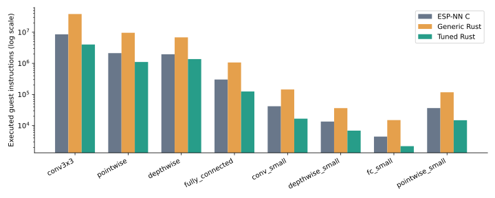
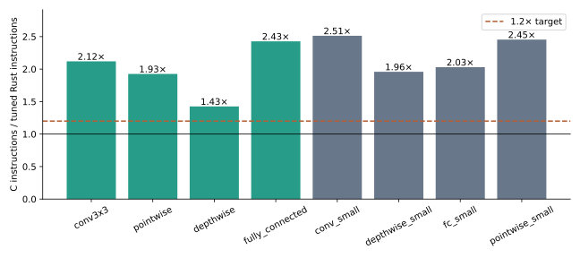
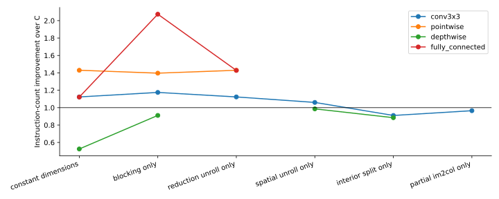
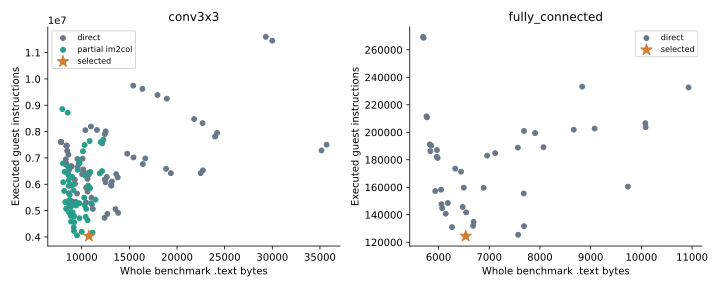

> This report records the original QEMU operator study. For current physical model
> results and tool scope, see [research summary](research-summary.md) and
> [V5 hardware evaluation](../results/hardware-v5/physical-audit/evaluation.md).

# Scalar RV32IMC INT8 Rust kernel tuning: measured evaluation

Full-network follow-up: [the pretrained person-detector evaluation](model-evaluation.md)
tests all 31 operators against independent LiteRT intermediate tensors and reports
complete-model instruction counts, code size, memory, and prediction limitations.

## Outcome

The four requested shapes achieved **1.938×** geometric-mean
instruction-count improvement over ESP-NN's C3-appropriate generic optimized C path.
All eight workloads achieved **2.077×**. These are QEMU executed
instruction ratios, not measured execution-time improvements or hardware cycles.
The three primary convolution operators alone achieve 1.798×,
excluding fully connected (whose C3 upstream dispatch is ANSI).
The 1.2× instruction-count target was met on both main aggregates.
All four requested workloads individually exceed 1.2× against ESP-NN.

See also [the additional muRISCV-NN comparison](competitor-evaluation.md),
including further optimization and optional upstream quantization validation.

## Prior work and contribution

[Related work](related-work.md) records ESP-NN, CMSIS-NN, muRISCV-NN, microTVM,
AutoTVM/Ansor, MicroFlow, tract, and MLonMCU, with source links and inspected commits.
Blocking, im2col, unrolling, quantization and Rust inference all have prior art.
The contribution here is a small, auditable engineering artifact combining
shape-specific Rust generation, a bounded grid, explicit resource constraints,
independent integer validation, and calibrated QEMU measurements against real
optimized upstream C. No algorithmic novelty or general Rust language advantage
is claimed.

## Baseline gate and target environment

`results/baseline-milestone.json` was saved after C passed all eight workloads,
before Rust reference measurements or optimized source generation. The original
baseline is ESP-NN commit `f1bfc45cb0edfdbe8fd4871f3abc0adfc7fe1c47`.
Convolution uses `esp_nn_conv_s8_opt`, depthwise uses
`esp_nn_depthwise_conv_s8_opt`; C3's fully connected implementation is
`esp_nn_fully_connected_per_ch_s8_ansi`. It is the library's actual scalar dispatch,
not a newly written naive comparison. The generic Rust baseline was also saved
before the grid. `results/phase-e/` preserves the first search before im2col and
interior splitting were introduced.

Toolchains: `riscv64-unknown-elf-gcc (14.2.0+19) 14.2.0`;
`rustc 1.90.0 (1159e78c4 2025-09-14)`;
`QEMU emulator version 10.0.13 (Debian 1:10.0.13+ds-0+deb13u1)`.
C uses `-O3 -march=rv32imc -mabi=ilp32`, freestanding, function/data sections,
no LTO. Rust uses stable 1.90.0, `riscv32imc-unknown-none-elf`, opt-level 3,
one codegen unit, panic abort, no LTO. Full flags/commands are saved in each row.
GCC and LLVM are different compilers, so this study does not isolate the language
from compiler and specialization effects.

QEMU runs bare-metal `virt` with the `lowrisc-ibex` RV32IMC CPU, one hart, 4 MiB
of emulator RAM and no firmware. The 4 MiB mapping is an emulator convenience;
per-workload deployment budgets are separately enforced. MMIO UART is at
0x10000000 and the test finisher at 0x100000. Startup and the measurement harness
use Zicsr for counter access; inference code is compiled for RV32IMC only.
No RVV, packed SIMD, floating point or hand-written inference assembly is used.
The `virt` machine is not an ESP32-C3 peripheral or timing model.

## What is measured

`-icount shift=0,align=off,sleep=off` enables deterministic guest instruction
counting. QEMU's RISC-V fixed-counter implementation uses `icount_get_raw()` for
`instret` ([source](https://github.com/qemu/qemu/blob/v10.0.0/target/riscv/csr.c)).
Two CSR reads enclose the same out-of-line function-pointer call for every
implementation. An empty callback measures common counter/call/argument-setup
overhead (15 instructions here), which is subtracted. The public kernel's
prologue, checks, parameters, scratch filling, accumulation, requantization,
clamping and return are included. Startup, fixture creation, validation, UART,
watermark scanning and shutdown are excluded. Raw and adjusted counts are saved.

Calibration loops execute exactly 2,000 or 4,000 loop instructions and return
2,001 / 4,001 including the CSR boundary instruction. Three fresh QEMU processes
per measurement produced identical counts and checksums. An independent QEMU
plugin counts each **executed** instruction via execution callbacks between the
same two PCs; it is not a count of translated instructions, translation blocks,
host operations or elapsed time. All 12 saved plugin cross-checks match
the CSR regions exactly. Counts assume normal kernel execution without faults
or asynchronous interrupts. QEMU host elapsed time is recorded only as search
cost and never used to select a kernel.

## Numerical contract and fixtures

Batch one NHWC activations; OHWI standard filters and HWC depthwise weights;
depthwise multiplier one; dilation one; stride/padding from TOML. Signed INT8
weights have zero point zero. Bias and accumulation are INT32. Default input
offset is -3, output offset +5, activation range [-111,103]. The exact per-channel
multiplier and shift arrays appear in each JSON row and `data.h`; workloads can
also supply explicit `multipliers` and `shifts` arrays. Default multiplier is
1073741824 + (channel mod 7) × 11234567; default shift is the specified
`quant_shift` minus channel mod 3. The default two-rounding ESP-NN requantization
path is used throughout, including negative rounding and saturation. No fast
non-bit-exact requantization option is enabled.

Xorshift32 seed 20261018 creates reproducible full-range signed inputs and
weights; biases use independent subsequent values. The Python INT64 oracle
implements operators independently. Every output byte, not only a checksum,
is compared in QEMU. Fixtures are checked to contain unsaturated outputs.
A host differential test covers 3,390 requantization cases against upstream C,
Python and Rust, including signs, ties, INT32 extremes, saturation and positive
shifts without overflow. Additional QEMU regression data includes 72
operator executions (three new seeds × eight workloads × three implementations),
with three deterministic process repeats per execution. A real deliberately
incorrect kernel was compiled, executed and rejected; evidence is retained.
These tests are extensive samples, not an exhaustive proof for arbitrary tensors.

## Complete comparison

| Workload | ESP-NN C | Generic Rust | Tuned Rust | C / tuned | Selected |
|---|---:|---:|---:|---:|---|
| conv3x3 | 8,546,046 | 38,396,168 | 4,032,868 | 2.119× | `b2_u1_s0_im2col_p4_qpos` |
| pointwise | 2,129,234 | 9,594,346 | 1,105,945 | 1.925× | `b4_u1_s0_p2_qpos` |
| depthwise | 1,955,993 | 6,841,273 | 1,372,290 | 1.425× | `b4_u1_s1_qpos` |
| fully_connected | 302,154 | 1,067,547 | 124,485 | 2.427× | `b8_u1_s0_qpos` |
| conv_small | 41,891 | 144,555 | 16,675 | 2.512× | `b2_u1_s1_qpos` |
| depthwise_small | 13,480 | 36,411 | 6,883 | 1.958× | `b1_u1_s1_cxy_qpos` |
| fc_small | 4,426 | 15,013 | 2,181 | 2.029× | `b8_u1_s0_qpos` |
| pointwise_small | 36,524 | 117,697 | 14,885 | 2.454× | `b2_u1_s0_qpos` |

Generic Rust is worse than C on every measured workload. Its dynamic dimensions,
index arithmetic, channel-loop control and remaining slice bounds checks are
visible in the disassembly. This result is retained rather than replacing the
baseline with a specialized Rust implementation.

## Generator and automatic search

The host Rust generator emits different scalar loop bodies. Direct variants
combine output-channel blocks 1/2/4/8, reduction unroll 1/4/8/16, and looped or
unrolled spatial taps. Odd channel counts exercise scalar tails. Additional
3×3 variants split interior and border pixels or use a one-output-pixel INT16
partial-im2col column. The column includes input offset and zero padding and is
filled inside the timed region. It never caches input-dependent work outside
the measurement. Im2col is not generated for depthwise or 1×1 operators.
Multipliers, shifts, inputs and weights remain runtime data in the generated
kernels. The extended search includes two-/four-pixel tiles, channel-first depthwise
loops and exact requantization restricted to nonnegative multipliers and
nonpositive shifts. Parameter checks stay inside the timed call. It does not
specialize individual multipliers or implement a new search algorithm. Bias, requantization and clamping
are fused in every variant; they are not claimed as an independently measured
new optimization. RV32M multiply and RV32C compression are compiler generated.

The final grid measured 588 candidates, with
0 incorrect/build-failed candidates and
54 correct candidates slower in instruction count
than C. All losing configurations remain in `results/candidates.json` and the
per-workload tuning files. Some distinct source schedules compile to equivalent
code, especially when a reduction is smaller than the unroll factor. Grid search
is deterministic; ties prefer smaller flash. Failed correctness/build tests are
excluded from selection. Configuration, source, compiler versions/binary hashes, flags, QEMU
configuration, harness, oracle and upstream files enter the SHA-256 cache key.

Objectives are minimum instructions, minimum flash, minimum instructions under
the TOML flash budget, or performance/flash Pareto selection. All enforce the
specified SRAM/flash budgets. SRAM selection includes the full 64 KiB reserved
stack plus .data/.bss, so observed stack watermarks are not treated as a formal
bound. Im2col scratch lives in that stack and is not counted twice. Flash budgets
use the complete executable's loadable text/rodata/data, including test fixtures
and the oracle, which is conservative for deployment.

The latest saved search (which may use the cache) took 323.14 host seconds summed
across sequential workload searches. Summed candidate compilation time is
224.64 seconds; cache hits retain original
compile measurements, so this sum is not a fresh-run wall-clock estimate.
Host timings are machine-specific orchestration costs.

A labeled search-cost snapshot is preserved in `results/search-cost.json`;
timings can include cache hits. The earlier experiment is retained separately
in `results/phase-before-muriscv/`.

## Ablation and trade-offs

The following are actual one-factor candidates from the grid, not estimated
contributions. Columns start from constant-dimension b1/u1/looped direct Rust.
The interior split also requires spatial unrolling. Missing cells were not
applicable/generated. Transformations interact, so differences are not additive.

| Workload | Constant dimensions | + block 4 only | + unroll 4 only | + spatial unroll only | + interior split | + partial im2col only |
|---|---:|---:|---:|---:|---:|---:|
| conv3x3 | 7,608,494 | 7,272,673 | 7,608,494 | 8,062,166 | 9,388,814 | 8,855,545 |
| pointwise | 1,489,271 | 1,524,735 | 1,489,271 | N/A | N/A | N/A |
| depthwise | 3,725,740 | 2,147,592 | N/A | 1,983,970 | 2,211,188 | N/A |
| fully_connected | 269,416 | 145,682 | 211,569 | N/A | N/A | N/A |

Output blocking reuses each input load and its offset across several output
channels; unrolling amortizes induction and branch instructions. Too much of
both increases register pressure. Generated 3×3 kernels reuse one or several INT16
columns across output channels; its fill and padded zero multiplies
are included. The selected fully connected schedule and its code/memory costs appear in
the table; aggressive unrolling can be harmful on that register budget. Depthwise cannot share
one input value across output channels in the same way, and ESP-NN already
blocks four channels, leaving a smaller gain. Interior splitting duplicated
large bodies and did not improve the final selection.

## Code size and memory

| Workload | C / tuned .text bytes | Tuned flash bytes | Static RAM | Stack watermark | Scratch included in stack |
|---|---:|---:|---:|---:|---:|
| conv3x3 | 8,438 / 10,756 | 28,720 | 8,192 | 1,388 | 1,152 |
| pointwise | 8,414 / 6,976 | 25,024 | 8,192 | 304 | 0 |
| depthwise | 10,256 / 8,680 | 42,516 | 16,396 | 304 | 0 |
| fully_connected | 5,720 / 6,536 | 41,484 | 132 | 304 | 0 |
| conv_small | 8,438 / 11,216 | 12,536 | 152 | 304 | 0 |
| depthwise_small | 10,270 / 8,310 | 9,482 | 116 | 304 | 0 |
| fc_small | 5,386 / 7,154 | 8,002 | 28 | 304 | 0 |
| pointwise_small | 8,438 / 7,856 | 8,844 | 324 | 536 | 0 |

.text is the complete linked benchmark text, including harness and any linked
upstream fallback/core routines, rather than source-file size. Flash additionally
includes immutable fixtures, weights, quantization arrays and expected outputs;
these raw sizes and ELF section listings are retained. Static RAM is .data/.bss
and includes the output tensor. Inputs/weights are immutable flash data in this
harness; real applications commonly put activations in SRAM and must budget that
separately. There is no kernel heap allocation and no hidden persistent packing.

Stack is an observed memory-pattern watermark including a 256-byte guard and
harness frames, not a formal worst-case stack proof. Untouched frame space or
values matching the watermark pattern can affect it. The full stack reservation
is always reported and used for resource feasibility. Im2col scratch requirements
are explicit in generated source comments and JSON, and are included in the
observed stack figure. The preserved `conv_small` b4/u16 im2col candidate demonstrates that low scratch
size alone does not prevent a large compiler-generated frame from aggressive
unrolling; it is no longer the selected kernel.

## Assembly evidence

Every measured candidate retains its ELF, disassembly, section sizes, link map
and ISA attributes under its content hash in `results/build/` (recreated by the
benchmark commands). `results/assembly-analysis.csv` locates selected and
regressing examples and records static disassembly facts, explicitly distinct
from dynamic instruction counts. On fully connected, b8/u16 performs
203,683
instructions versus 124,485 for b8/u1;
its larger frame and additional stack load/store sites are consistent with
register spilling. The loop bodies use signed `lb`, scalar `mul`/`add`, pointer
updates and branches; requantization also uses the scalar RV32M high-multiply
operations generated by the compiler. Compressed 16-bit encodings reduce bytes,
but each still counts as one instruction. Static counts of spills/compressed
instructions alone do not establish hardware latency savings.

## Limits and future ESP32-C3 validation

Instruction counts give a reproducible surrogate; they do not model C3 pipeline
latencies, flash/cache misses, memory bandwidth, branch costs, power or interrupts.
An extra instruction may be cheap and fewer loads may matter more on hardware.
The suite contains eight isolated layers, not complete neural networks or model
accuracy/latency evaluations. Shape specialization, known input/output offsets,
and GCC versus LLVM confound a pure language comparison. Per-channel multipliers
stay dynamic, but some other quantization/shape metadata is specialized. Library
C is compiled as reusable functions, while generated Rust has workload constants;
that is the intended generator comparison, not proof that generic Rust beats C.
Selected kernels may increase flash and stack, as the tables show. Resource
constraints cover this harness; deployment placement must be reassessed.

Future hardware work should use ESP-IDF/esp-hal on a real C3, pin clock/cache
settings, measure `mcycle`/`minstret` over identical kernels with interrupts
controlled, report medians/distributions and empty-region overhead, and compare
flash versus SRAM placement. Validate every output again and report actual cycle
ratios separately from these QEMU instruction ratios. No hardware backend or
hardware performance result is claimed in this release.

## Reproduction and artifacts

Run `bash scripts/reproduce.sh` after setup; see [README](../README.md).
The Rust CLI uses a Python build/QEMU/fixture backend, with all search and source
generation in Rust. `cargo run -p autotuner -- compare` regenerates this report,
JSON/CSV tables and SVG/PNG/PDF plots exclusively from saved measurements.
`cargo run -p autotuner -- export` emits independently reusable no_std files
with safe slice entry points and documented C ABI wrappers. No placeholder
performance values or hardcoded expected speedups are used.
